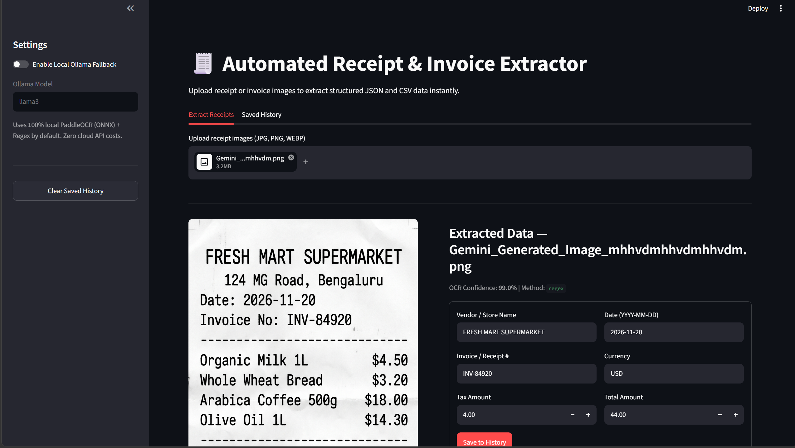
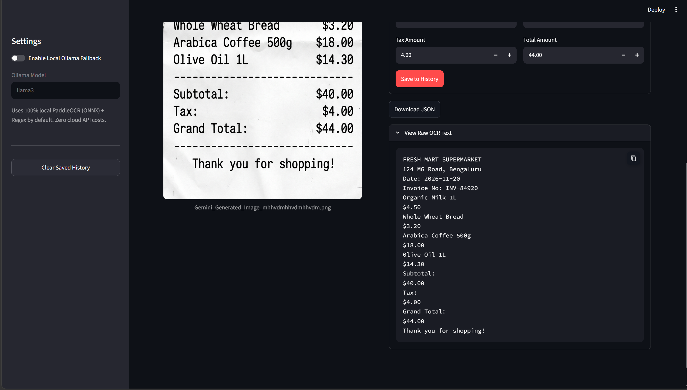

# 🧾 Automated Receipt & Invoice Extractor

A production-ready, privacy-first web application that converts receipt and invoice images into structured **JSON** and **CSV** data. Built with **RapidOCR (PaddleOCR on ONNX Runtime)**, **OpenCV**, **Regex + optional local Ollama LLM fallback**, **SQLite**, and **Streamlit**.

---

## ✨ Key Features

- **100% Local & Zero-Cost OCR:** Runs PaddleOCR models on lightweight ONNX Runtime (`rapidocr-onnxruntime`) for fast CPU inference and low memory usage—no paid cloud OCR APIs required.
- **Automated Image Preprocessing:** Auto-orients photos, upscales low-resolution scans, and applies CLAHE contrast enhancement via OpenCV before reading text.
- **Hybrid Extraction Engine:**
  - **Deterministic Regex Parser:** Extracts Vendor Name, Date (`YYYY-MM-DD`), Invoice/Receipt Number, Currency, Tax Amount, and Total Amount.
  - **Optional Local Ollama Fallback:** Toggleable local LLM refinement (`llama3`, `qwen2:0.5b`, etc.) for messy or non-standard invoices.
- **Human-in-the-Loop Verification:** Side-by-side image preview and editable form so users can verify or adjust any field before saving.
- **Batch Processing & History:** Upload multiple receipts at once, store verified records in SQLite, and export single receipts as **JSON** or full history as **CSV**.

---

## 📸 Output Previews

### 1. Receipt Extraction & Verification


### 2. Bulk CSV Export


---

## 🛠️ Tech Stack

| Layer | Technology |
| :--- | :--- |
| **Frontend** | Streamlit |
| **OCR Engine** | RapidOCR (`rapidocr-onnxruntime`) |
| **Image Processing** | OpenCV (`opencv-python-headless`), Pillow |
| **Data Parsing** | Python Regex (`re`) + Optional Local Ollama API |
| **Database** | SQLite (`sqlite3`) |
| **Deployment** | Docker / Streamlit Community Cloud / Hugging Face Spaces |

---

## 📁 Project Structure

```text
receipt-extractor/
├── app.py                  # Streamlit UI (upload, verify, export, history)
├── core/
│   ├── __init__.py
│   ├── ocr_engine.py       # OpenCV preprocessing + RapidOCR inference
│   ├── parser.py           # Regex extraction + optional Ollama refinement
│   └── database.py         # SQLite persistence layer
├── assets/
│   ├── extraction_demo.png # UI preview 1
│   └── history_demo.png    # UI preview 2
├── requirements.txt        # Python dependencies
├── Dockerfile              # Containerized production build
├── .gitignore
└── README.md
